<!-- Every card is an animated SVG drawn by scripts/render_cards.py and refreshed daily
     by .github/workflows/refresh-cards.yml. Design: "Three Worlds", matched to
     avivashishta.com — paper, ink and one colour per world. The hero portrait is
     an ASCII rendition of the GitHub profile photo in assets/source-photo.jpg.
     Spacing is baked into the SVGs, so keep this block free of blank lines and keep
     the cards in a row on one line with no stray spaces between them. -->

 
 
 
&nbsp;&nbsp; 
<picture><source media="(prefers-color-scheme: dark)" srcset="./cards/title-coding-dark.svg" /></picture> 
 

<a href="https://hammad-developer.vercel.app/">hammad-developer.vercel.app</a> &nbsp;/&nbsp; <a href="https://www.linkedin.com/in/hammad-jawaid-4610793ba/">linkedin</a> &nbsp;/&nbsp; <a href="mailto:droidhammad2006@gmail.com">email</a> &nbsp;/&nbsp; <a href="https://hammad-developer.vercel.app/Hammad-Jawaid-CV.pdf">résumé</a> &nbsp;/&nbsp; <a href="https://hammad-developer.vercel.app/hire.html">hire me</a>

