


  
  
  
  

  JUMP TO&nbsp;
  <a href="#about">ABOUT</a> &nbsp;·&nbsp;
  <a href="#stack">STACK</a> &nbsp;·&nbsp;
  <a href="#work">WORK</a> &nbsp;·&nbsp;
  <a href="#process">PROCESS</a> &nbsp;·&nbsp;
  <a href="#stats">STATS</a> &nbsp;·&nbsp;
  <a href="#contact">CONTACT</a>


> **I build full-stack web apps, end to end.** The interface, the API and the database — all the way to live, not just to a screenshot.

<table>
<tr>
<td width="33%" valign="top">
<b>&#9656; WHO</b>  
Full-stack developer from <b>Karachi, Pakistan</b>. Responsive interfaces in HTML, CSS and JavaScript — APIs in PHP and Node.js — MySQL and MongoDB underneath. One project at a time, idea to live.
</td>
<td width="33%" valign="top">
<b>&#9656; HOW</b>  
<b>I learn by building.</b> Every project connects one more piece of the stack. I care about the craft: readable, well-structured, maintainable code — fast on every device, pixel-perfect on every screen.
</td>
<td width="33%" valign="top">
<b>&#9656; NOW</b>  
<b>Open to work.</b> Freelance, contracts and full-time opportunities — based in Karachi, building for anywhere. My inbox is always open for a project worth doing properly.
</td>
</tr>
</table>

 

> *"I'd rather take extra time to get something right than ship something I'm not proud of."*

<b>&#9656; The long version</b>

 

- I don't hand off at the boundary between front end and back end — I own the whole path from a blank file to a deployed URL.
- I'd rather understand a problem fully before writing the first line than patch it later.
- Everything I list below is something I've actually shipped, not a tutorial I finished.


   
  

| Layer | What I reach for |
| ----- | ---------------- |
| **Front end** | [HTML](https://developer.mozilla.org/docs/Web/HTML) · [CSS](https://developer.mozilla.org/docs/Web/CSS) · [JavaScript](https://developer.mozilla.org/docs/Web/JavaScript) · [React](https://react.dev/) · [Vite](https://vite.dev/) · [Tailwind](https://tailwindcss.com/) |
| **Back end** | [PHP](https://www.php.net/) · [Node.js](https://nodejs.org/) · [Express](https://expressjs.com/) · [PHPMailer](https://github.com/PHPMailer/PHPMailer) |
| **Databases** | [MySQL](https://www.mysql.com/) · [MongoDB](https://www.mongodb.com/) |
| **Ship it** | [Git](https://git-scm.com/) · [GitHub](https://github.com/) · [Vercel](https://vercel.com/) |

<b>&#9656; Where each one is verified</b>

 

- **CTRL ZONE** → PHP, MySQL (PDO), PHPMailer — [public source](https://github.com/hammadjawaiddev/ctrlzone).
- **Campus Coin** → React, Vite, Tailwind, Express, MongoDB — source is no longer public, so only the [live app](https://campuscoin-sable.vercel.app/) is linked.
- **PhysioSync, PathSeeker, FurShield** → source isn't public on my GitHub yet, so their stacks aren't guessed; they're described by what they do instead.

I only list what I can point to. No inflated logo walls, no "familiar with" filler.


<table align="center">
<tr>
<td align="center" width="33%" valign="top">
  <a href="https://physiosync-pk.vercel.app/"></a> 
  <a href="https://physiosync-pk.vercel.app/"><b>LIVE &#8599;</b></a>
</td>
<td align="center" width="33%" valign="top">
  <a href="http://ctrlzone.infinityfreeapp.com/"></a> 
  <a href="http://ctrlzone.infinityfreeapp.com/"><b>LIVE &#8599;</b></a> &nbsp;·&nbsp; <a href="https://github.com/hammadjawaiddev/ctrlzone">CODE</a>
</td>
<td align="center" width="33%" valign="top">
  <a href="https://careerpassporttw.vercel.app/"></a> 
  <a href="https://careerpassporttw.vercel.app/"><b>LIVE &#8599;</b></a>
</td>
</tr>
<tr>
<td align="center" width="33%" valign="top">
  <a href="https://furshiel.vercel.app/"></a> 
  <a href="https://furshiel.vercel.app/"><b>LIVE &#8599;</b></a>
</td>
<td align="center" width="33%" valign="top">
  <a href="https://campuscoin-sable.vercel.app/"></a> 
  <a href="https://campuscoin-sable.vercel.app/"><b>LIVE &#8599;</b></a>
</td>
<td align="center" width="33%" valign="top">
  <a href="https://hammad-developer.vercel.app/"></a> 
  <a href="https://hammad-developer.vercel.app/"><b>PORTFOLIO &#8599;</b></a>
</td>
</tr>
</table>

All six destinations above are live. Stack tags appear only where source backs them up; the rest are feature tags, not tech guesses.


<table>
<tr>
<td width="25%" valign="top"><b>01 &#183; IDEA</b>  Understand the problem before touching a keyboard. What should this actually do for the person using it?</td>
<td width="25%" valign="top"><b>02 &#183; INTERFACE</b>  Responsive, pixel-perfect HTML/CSS/JS or React. Fast on a phone, calm on a desktop.</td>
<td width="25%" valign="top"><b>03 &#183; API + DATA</b>  PHP or Node/Express over MySQL or MongoDB. Structured, readable, built to be changed later.</td>
<td width="25%" valign="top"><b>04 &#183; SHIP</b>  Deploy it, test it on real devices, and leave the code clean enough for the next person — including future me.</td>
</tr>
</table>

 

| NOW | NEXT | ALWAYS |
| --- | ---- | ------ |
| Open to freelance, contracts and full-time roles. | Connecting one more piece of the stack with every project. | Craft over speed. Learn by building. Ship things I'm proud of. |


  
  

  

<b>&#9656; More signal — activity graph &amp; trophies</b>

 

  

  


  <b>Got a project? Let's build the whole thing</b> — from the interface to the server to the database. 
  My inbox is always open, and I read every message.

  
  

| | |
| - | - |
| **Email** | [droidhammad2006@gmail.com](mailto:droidhammad2006@gmail.com) |
| **Portfolio** | [hammad-developer.vercel.app](https://hammad-developer.vercel.app/) |
| **Résumé** | [Hammad-Jawaid-CV.pdf](https://hammad-developer.vercel.app/Hammad-Jawaid-CV.pdf) |
| **Hire me** | [hammad-developer.vercel.app/hire.html](https://hammad-developer.vercel.app/hire.html) |
| **Based in** | Karachi, Pakistan · open to remote and on-site worldwide |

Built with a little HTML, a lot of SVG, and an unreasonable attention to detail. 

