  
  
  
  

## 🧠 About

- **I build full-stack web apps, end to end.** Responsive interfaces in HTML, CSS and JavaScript — APIs in PHP and Node.js — MySQL and MongoDB underneath. One project at a time, idea to live.
- **I learn by building.** Every project is a chance to connect one more piece of the stack.
- **I care about the craft:** readable, well-structured, maintainable code — fast on every device, pixel-perfect on every screen.
- **Open to work.** Freelance, contracts and full-time opportunities — Karachi, Pakistan, building for anywhere.

> *"I'd rather take extra time to get something right than ship something I'm not proud of."*

## 🛠️ Tech Stack

  

  

| Front end | Back end | Databases | Tools |
| --------- | -------- | --------- | ----- |
| HTML · CSS · JavaScript · React (Vite · Tailwind) | PHP · Node.js · Express | MySQL · MongoDB | Git · GitHub · Vercel |

Listed only what's verified in my repos and portfolio — React/Vite/Tailwind from Campus Coin, PHP/MySQL from CTRL ZONE, Node/Express/MongoDB from Campus Coin.

## 🚀 Featured Projects

| Project | What it is | Stack | Links |
| ------- | ---------- | ----- | ----- |
| **PhysioSync** | Physiotherapy clinic — calm, conversion-oriented, fast on any device; interactive 3D anatomy, EN/Urdu | Not verified¹ | [Live](https://physiosync-pk.vercel.app/) |
| **CTRL ZONE** | Gaming-peripherals store — browse, register, cart, checkout, order history + admin panel (products, orders, coupons) | PHP · MySQL (PDO) · PHPMailer | [Live](http://ctrlzone.infinityfreeapp.com/) · [Code](https://github.com/hammadjawaiddev/ctrlzone) |
| **PathSeeker** | Career-discovery app — turns a broad question into a tailored path | Not verified¹ | [Live](https://careerpassporttw.vercel.app/) |
| **FurShield** | Pet care for owners, vets and shelters — health timelines, documents, insurance, smart vet matching, adoption | Not verified¹ | [Live](https://furshiel.vercel.app/) |
| **Campus Coin** | Student budget tracker — type what you spent or import a CSV; it categorises, charts, warns | React · Vite · Tailwind · Express · MongoDB | [Live](https://campuscoin-sable.vercel.app/) · [Code](https://github.com/hammadjawaiddev/campus-coin) |

¹ Source for PhysioSync, PathSeeker and FurShield isn't public on my GitHub yet, so their stacks are left unverified rather than guessed. All five sites are live and confirmed.

## 📊 GitHub Stats

  
  

  

## 🤝 Let's Build the Whole Thing

Got a project? Let's build the whole thing — from the interface to the server to the database. My inbox is always open.

- **Email** — [droidhammad2006@gmail.com](mailto:droidhammad2006@gmail.com)
- **Portfolio** — [hammad-developer.vercel.app](https://hammad-developer.vercel.app/)
- **Résumé** — [Hammad-Jawaid-CV.pdf](https://hammad-developer.vercel.app/Hammad-Jawaid-CV.pdf)
- **Hire me** — [hammad-developer.vercel.app/hire.html](https://hammad-developer.vercel.app/hire.html)

