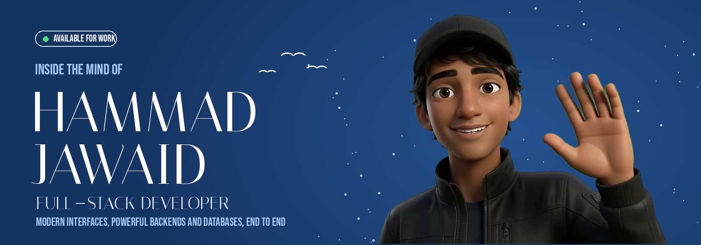

  
  
  
  

# Hammad Jawaid — Full-Stack Developer in Karachi, Pakistan

**Full-stack web developer** building modern, responsive websites and web applications end to end: front-end development in **HTML, CSS, JavaScript and React**, back-end development and REST APIs in **PHP and Node.js (Express)**, and databases in **MySQL and MongoDB**. Based in Karachi, Pakistan — available for **freelance projects, contract work and full-time remote roles** worldwide.

## 🧠 About Hammad Jawaid

- **I build full-stack web apps, end to end.** Responsive interfaces in HTML, CSS and JavaScript — APIs in PHP and Node.js — MySQL and MongoDB underneath. One project at a time, idea to live.
- **I learn by building.** Every project is a chance to connect one more piece of the stack.
- **I care about the craft:** readable, well-structured, maintainable code — fast on every device, pixel-perfect on every screen.
- **Open to work.** Freelance, contracts and full-time opportunities — Karachi, Pakistan, building for anywhere.

> *"I'd rather take extra time to get something right than ship something I'm not proud of."*

## 💼 Web Development Services

Hire me to design, build and deploy:

- **Business websites & landing pages** — fast, responsive, built to convert visitors into customers
- **Full-stack web applications & dashboards** — accounts, admin panels, charts and business logic
- **E-commerce / online stores** — product catalog, cart, checkout, orders and admin management
- **REST API & back-end development** — clean Node.js/Express or PHP APIs with authentication
- **Database design** — MySQL and MongoDB schemas built for the way your app actually queries data
- **Website fixes, speed & polish** — bug fixes, performance optimisation and responsive clean-up

## 🛠️ Tech Stack — Full-Stack Development Skills

  

  

| Front end | Back end | Databases | Tools |
| --------- | -------- | --------- | ----- |
| HTML · CSS · JavaScript · React (Vite · Tailwind) | PHP · Node.js · Express | MySQL · MongoDB | Git · GitHub · Vercel |

Listed only what's verified in my repos and portfolio — React/Vite/Tailwind from Campus Coin, PHP/MySQL from CTRL ZONE, Node/Express/MongoDB from Campus Coin.

## 🚀 Featured Projects — Live Full-Stack Portfolio Work

| Project | What it is | Stack | Links |
| ------- | ---------- | ----- | ----- |
| **PhysioSync** | Physiotherapy clinic website — calm, conversion-oriented, fast on any device; interactive 3D anatomy, EN/Urdu | JavaScript · Responsive UI | [PhysioSync physiotherapy clinic website — live](https://physiosync-pk.vercel.app/) |
| **CTRL ZONE** | Gaming-peripherals e-commerce store — browse, register, cart, checkout, order history + admin panel (products, orders, coupons) | PHP · MySQL (PDO) · PHPMailer | [CTRL ZONE online store — live](https://ctrlzone.infinityfreeapp.com/) · [CTRL ZONE source code on GitHub](https://github.com/hammadjawaiddev/ctrlzone) |
| **PathSeeker** | Career-discovery web app — turns a broad question into a tailored career path | JavaScript · Node.js · MongoDB | [PathSeeker career discovery app — live](https://careerpassporttw.vercel.app/) |
| **FurShield** | Pet-care platform for owners, vets and shelters — health timelines, documents, insurance, smart vet matching, adoption | JavaScript · Node.js · MongoDB | [FurShield pet care platform — live](https://furshiel.vercel.app/) |
| **Campus Coin** | Student budget tracker web app — type what you spent or import a CSV; it categorises, charts, warns | React · Vite · Tailwind · Express · MongoDB | [Campus Coin budget tracker — live](https://campuscoin-sable.vercel.app/) · [Campus Coin source code on GitHub](https://github.com/hammadjawaiddev/campus-coin) |

All five projects are live and confirmed. Source for PhysioSync, PathSeeker and FurShield isn't public on my GitHub yet, so their stacks are listed from the live builds rather than guessed.

## ❓ Frequently Asked Questions

### Who is Hammad Jawaid?
Hammad Jawaid is a full-stack developer based in Karachi, Pakistan. He builds responsive front ends in HTML, CSS, JavaScript and React, back ends and REST APIs in PHP and Node.js, and database-driven applications with MySQL and MongoDB — five live projects shipped end to end, from first screen to deployment.

### How can I hire Hammad Jawaid as a freelance web developer?
Message him on [the hire page](https://hammad-developer.vercel.app/hire.html) (WhatsApp is fastest) or email [droidhammad2006@gmail.com](mailto:droidhammad2006@gmail.com). Pick what you need — website, web app, online store, API or database — and he'll reply with an honest scope, timeline and quote.

### What technologies does Hammad Jawaid work with?
Front end: HTML, CSS, JavaScript and React (Vite, Tailwind). Back end: PHP and Node.js with Express. Databases: MySQL and MongoDB. Workflow: Git, GitHub and modern deployment platforms.

### Is Hammad Jawaid available for full-time or remote work?
Yes — freelance projects, contracts and full-time opportunities, remote from Karachi, Pakistan, for clients anywhere in the world.

### Where can I see Hammad Jawaid's live work?
All five featured projects above are deployed and clickable, more code is on [GitHub](https://github.com/hammadjawaiddev), and the full portfolio is at [hammad-developer.vercel.app](https://hammad-developer.vercel.app/).

## 📊 GitHub Stats

  
  

  

## 🤝 Hire a Full-Stack Developer — Let's Build the Whole Thing

Got a project? Let's build the whole thing — from the interface to the server to the database. My inbox is always open.

- **Email** — [droidhammad2006@gmail.com](mailto:droidhammad2006@gmail.com)
- **Portfolio** — [Hammad Jawaid's full-stack developer portfolio](https://hammad-developer.vercel.app/)
- **Résumé** — [Hammad Jawaid CV (PDF)](https://hammad-developer.vercel.app/Hammad-Jawaid-CV.pdf)
- **Hire me** — [Hire Hammad Jawaid for your next web project](https://hammad-developer.vercel.app/hire.html)
- **LinkedIn** — [Hammad Jawaid on LinkedIn](https://www.linkedin.com/in/hammad-jawaid-4610793ba/)

