  
  
  

 

**Got a project? Let's build the whole thing** — interface, API, database, all the way to live. 
Freelance, contracts and full-time · Karachi, Pakistan · building for anywhere.

  
  
  
  

Cards are generated from <code>data/contributions.json</code> by <code>scripts/render_cards.py</code> and refreshed daily by a GitHub Action. Motion respects <code>prefers-reduced-motion</code>.

